<!--
  Profile README — "Oxide 1-6 // Surveillance Console"
  Every panel is a self-contained animated SVG generated by assets/build.py,
  which drives the modular generator in assets/builder/ (Departure Mono font +
  dithered headshot embedded; CSS animations run inside GitHub's 
  rendering). Live stats, languages, the contribution calendar, and the
  rotating quote are fetched at build time.
  Regenerate with:  python assets/build.py
  .github/workflows/refresh-profile.yml re-runs it every 3 hours.
  Section panels span the profile width; social feeds and rice recordings use columns.
  NOTE: paragraph groups retain GitHub's normal spacing between sections.
  The uplink header is embedded in its tiles to stay attached at mobile widths.
  Rice recordings use a two-column table for native playback, with one shared
  heading, individual tape labels, and one clickable source row per recording.
-->


<!-- ================= TELEMETRY (self-hosted; regenerate with assets/build.py) ================= -->

<!-- ================= COLLABORATIVE ENGINEERING (one continuous panel, three clickable regions;
     keep the adjacent slices aligned so the shared frame remains seamless) ================= -->

<a href="https://github.com/vinnovateit/latch/pulls?q=is%3Apr+is%3Amerged+author%3Arugbedbugg"></a>
<a href="https://github.com/boykopovar/AnyPS5/pull/4195"></a>
<a href="https://github.com/search?q=is%3Apr+is%3Amerged+is%3Apublic+author%3Arugbedbugg+-user%3Arugbedbugg&amp;type=pullrequests&amp;s=updated&amp;o=desc"></a>

<!-- ================= ESTABLISH UPLINK (one group, three independently clickable feeds) ================= -->

<a href="https://linkedin.com/in/partha-gogoi-736241308"></a><a href="mailto:yes.par781@gmail.com?subject=GitHub%20Contact&body=Hi%20Partha%2C%0A%0AI%20found%20you%20via%20GitHub.%0A"></a><a href="https://discord.com/users/848834469033017374"></a>

<!-- ================= FIELD RECORDINGS (real video attachments, tape labels and source links;
     one shared section heading, named tape subheadings, and spacing between groups) ================= -->

<table width="100%">
<tr>
<td width="50%" valign="top"><video src="https://github.com/user-attachments/assets/83d512dd-0014-42d0-9bfd-7520563b77e0" controls width="100%" aria-label="0xIde — Arch and Hyprland desktop recording"></video></td>
<td width="50%" valign="top"><video src="https://github.com/user-attachments/assets/f5a19ea3-f70b-426a-8e5a-bf4c54403474" controls width="100%" aria-label="0xNix — NixOS and Hyprland desktop recording"></video></td>
</tr>
<tr>
<td width="50%"><a href="https://github.com/rugbedbugg/0xIde"></a></td>
<td width="50%"><a href="https://github.com/rugbedbugg/0xNix"></a></td>
</tr>
</table>

<a href="https://github.com/skolakoda/programming-quotes-api/blob/master/data/quotes.json"></a>
